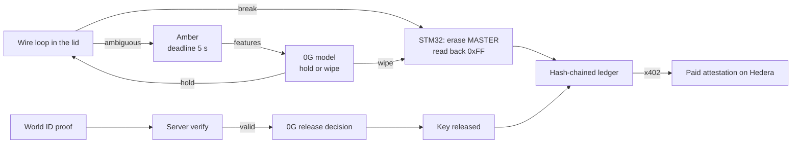

# Ash

Ash is a tamper-responsive seal for confidential shipments. The payload key lives in the STM32U585
inside the case. If the loop breaks, the MCU erases the key. If the event is ambiguous, a 0G model
decides hold or wipe against a deadline. Unsealing needs a World ID proof and a 0G release decision.

Status: runs on hardware. Site and API are live.

| | |
|---|---|
| Site | https://ash.langersword.in |
| API | https://api.langersword.in |
| Video script | `demo-script.md` |
| Submission text | `submission-copy.md` |

## Flow



## Response tiers

- **Tier 0. Hard break.** The loop opens. The MCU erases MASTER and reads the page back. No network.
  No host.
- **Tier 1. Ambiguous event.** The MCU goes amber and sends a feature vector to 0G. 0G answers hold
  or wipe within 5 s. A timeout, a network error, or a malformed answer wipes.
- **Tier 2. Authorised unseal.** The server verifies a World ID proof. 0G returns release or deny.
  Only release derives the payload key again.

## Layout

```
firmware/ash_mcu/  STM32 sketch: state machine, flash wipe, sensing, 13x8 matrix
firmware/ash_app/  board-side bridge to the host
device/            Python service: vault, 0G, World, Hedera, HTTP API
site/              Svelte 5 + GSAP site, built by GitHub Actions
app/               Tauri v2 desktop shell (in progress)
tools/             relay, x402 client and facilitator, World helper, grader
docs/              ARCHITECTURE, SECURITY, AI_USE
```

## Run

```bash
python3 -m venv .venv && . .venv/bin/activate
pip install -r requirements.txt
python3 device/demo_api.py
curl -s localhost:8080/status
```

The service finds the board over `adb forward`. Set `ASH_MCU=board` to use it. Without a board it
reports `absent` and disables the device calls.

## API

| Method | Path | Purpose |
|---|---|---|
| GET | `/status` | MCU state, counter, master flag, loop state |
| GET | `/device` | adb state, serial, forwarded port |
| POST | `/seal` | encrypt a payload under a derived key |
| POST | `/unseal` | verify proof, ask 0G, release or refuse |
| POST | `/sim` | drive the loop for a rehearsal |
| GET | `/ledger` | hash-chained episode records |
| GET | `/attestation/{container}` | 402 challenge, then the signed record |

## Measured

| Item | Value |
|---|---|
| Erase | 874 µs |
| Wipe and read-back | 1 321 µs |
| Bridge round trip | p50 6.19 ms, p95 7.20 ms, 1 000 calls, 0 errors |
| 0G decision | 2.05 s median, p95 2.11 s |
| Deadline | 5 000 ms |

Settled payments on Hedera testnet. The mirror node reports `SUCCESS` for both.

```
0.0.11340251@1793997107.642204384
0.0.11340251@1793997690.385465376
```

## Limits

- Not a certified secure element. A bench attacker with SWD access can read the MCU.
- The loop covers one path. Opening the enclosure by other means is out of scope.
- World verification is implemented. The success scan is not done yet.
- The board has no RTC. Its clock runs slow, so TLS goes through the laptop relay.
- The desktop AppImage is not published yet.

## Verify

```bash
.venv/bin/python tools/grade.py                  # 12 checks, 7 negative controls
ASH_GRADE_HW=1 .venv/bin/python tools/grade.py   # adds a real wipe and re-arm
.venv/bin/python tools/check_braces.py           # code blocks hold literal braces
python -m pytest device -q                       # vault, seal service, providers
```

The grade reads the live site and API, recomputes the claimed numbers from `/evidence`, checks the
transaction ids against the Hedera mirror node, and grades the seal/unseal policy against an oracle.
